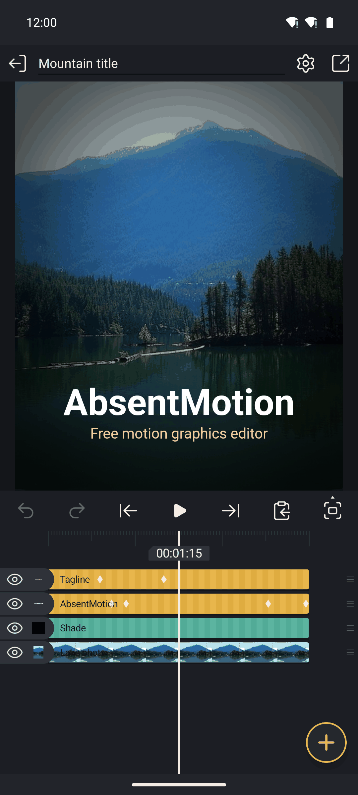
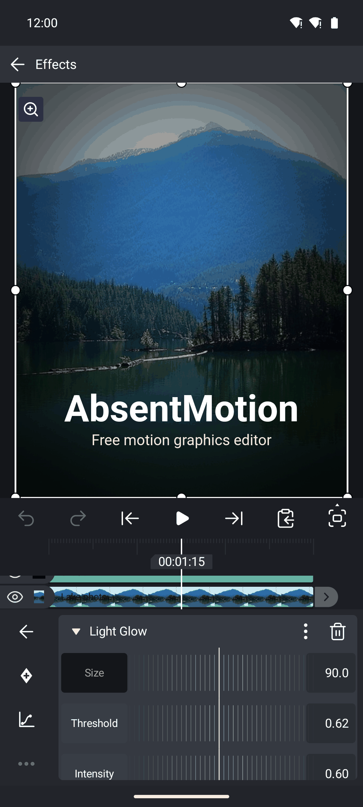

# Clipora

<p align="center">
  <a href="https://github.com/ariskaAdi/Clipora/releases/latest"></a>
  <a href="LICENSE"></a>
  <a href="#requirements"></a>
</p>

Clipora is a free, open-source video editor for Android with a CapCut-style workflow: pick your clips in order, and they
land on the timeline one after another, ready to cut. Underneath it is a full motion graphics editor with keyframes,
effects, 3D layers and export, all running on your phone. It works without an internet connection, with no account, no
subscription, no ads and no trackers. Your projects never leave your device.

Clipora is based on [AbsentMotion](https://github.com/Comett1225/AbsentMotion), the open-source motion graphics editor,
and keeps its engine and features. See [Credits](#credits).

<p align="center">
  
  &nbsp;&nbsp;
  
</p>
<p align="center"><sub>Photo: Ruby Mountain reflected in Diablo Lake, public domain (CC0), Wikimedia Commons.</sub></p>

## What Clipora adds

- **New project from your gallery.** Tap **New project**, choose photos and videos in the order you want, and tap
  **Add**. The project takes the shape of your first clip and opens with every clip placed back to back on the timeline.
  **Blank project** is still there for motion graphics with a custom size, frame rate and background.
- **A gallery picker built for editing.** Pick the album from a menu that drops down from the top, filter by All, Videos
  or Photos, and see a numbered badge on each pick. The tray at the bottom shows your picks in order, and you can remove
  any of them before adding. **Other apps** opens the system picker when your media lives somewhere else.
- **Added clips go to the end.** In the editor, new photos and videos join the end of your existing clips instead of
  stacking on top of them. Drag a clip if you do want it layered. Sounds still go in at the playhead.
- **Frame capture in batches.** Open **Screenshot** on a video clip, move the playhead and tap **Capture** as many times
  as you like. Check the frames in the strip, remove the ones you don't want, then **Save all**. They are saved to your
  gallery and added to the timeline one after another, in a single step you can undo.
- **A new home screen.** A big **New project** button, a grid of shortcuts to the tools (Trim, Compress, Extract audio,
  Make a GIF, Enhance quality, Templates, Import project, All tools) and your projects underneath.

## Features

<details>
<summary><strong>Layers and a timeline</strong></summary>

Shapes, text, images, video, audio, freehand drawings, groups, reusable elements, 3D models, lights and null objects, with trimming, splitting, moving and stretching several clips at once, parenting, groups you can open and ungroup, clipping masks, label colours, bookmarks, slide-to-select and frame-accurate snapping.

</details>

<details>
<summary><strong>Keyframes with easing</strong></summary>

Any value (position, size, rotation, 3D tilt, skew, opacity, colour, shape and effect parameters) can be keyframed. Easing is a cubic Bezier, bounce, elastic, cyclic, random or stepped curve, edited with handles on a graph.

</details>

<details>
<summary><strong>213 effects</strong></summary>

Colour, blur, distort, stylize, noise, keying, Move (Auto-Shake, Oscillate, Swing, Spin, Random Displacement, Random Jitter, Pulse, Echo, Offset, Move Along Path, true motion blur, Parenting Helper, Scale Assist), Repeat (linear, radial, grid, along a path, scatter, with a delay and random variation per copy), 3D objects (cube, sphere, torus, prisms, raster extrude and more), Text (typewriter reveal, per-letter transforms, shaking letters, talking blips, font weight, scramble, count up, timecode), ASCII art, Copy Background (an adjustment layer), VHS, Datamosh, Glass, Displacement Map and many more, with animated previews, presets and a "New" category.

</details>

<details>
<summary><strong>Transitions and animations</strong></summary>

One-tap transitions between clips and In / Out / Loop animations for any layer, written as ordinary keyframes you can edit.

</details>

<details>
<summary><strong>Shapes and drawing</strong></summary>

Parametric shapes, vector paths with point editing and animated (rotoscoping) masks, SVG import, freehand pen, brush, fill and eraser, borders, shadows, gradients and blend modes. Colour palettes in every colour picker: make them from a picture or a palette file (.gpl, .ase, .act, .pal or hex), sort and lock them, and export them as PNG, .gpl or .ase.

</details>

<details>
<summary><strong>Text</strong></summary>

Text layers with spacing and alignment, 50 fonts built in and 100 more to download from Google Fonts. Letters can shake on their own, type out with a blip for each letter like game dialogue, and change weight with variable fonts.

</details>

<details>
<summary><strong>Video tools</strong></summary>

Speed ramps with presets and freeze frames, motion tracking, background removal for photos and videos, frame blending and optical-flow slow motion, batch frame capture, preview copies for heavy 4K videos, and an in-app camera.

</details>

<details>
<summary><strong>Camera layers and 3D</strong></summary>

A 3D camera with perspective or orthographic projection, focus blur, fog, motion blur and one-tap Camera Moves (push in, pull out, orbit, pan, dolly zoom, handheld). Layers in 3D sort by their distance from the camera, and Ambient, Directional and Point lights shade 3D models and 3D effects.

</details>

<details>
<summary><strong>Audio</strong></summary>

Audio layers and the sound of video clips, a waveform view, volume, audio effects (EQ, filters, reverb, echo, compressor, noise gate, limiter, with presets), beat detection (Mark Beats) and noise reduction.

</details>

<details>
<summary><strong>Offline text to speech and auto captions</strong></summary>

Offline text to speech with the voices already on the device, and auto captions with on-device speech recognition (whisper.cpp; the speech model is downloaded once, after the app tells you its size).

</details>

<details>
<summary><strong>Export</strong></summary>

MP4, MOV, MKV or WebM video (H.264, HEVC, AV1, VP9 or APV, as the phone supports), audio only (WAV, FLAC, M4A, OGG or MP3), animated GIF, image sequences and single frames, with a time estimate, a storage check, protection when the phone is hot and a check of every finished file.

</details>

<details>
<summary><strong>Tools</strong></summary>

**Compress** makes videos and pictures smaller and lets you watch the result before saving. **Trim** cuts a video fast without re-encoding, or exactly. **Extract audio** saves the sound of a video as M4A or MP3. **Make a GIF** turns up to 30 seconds of a video into a GIF. **Enhance quality** upscales pictures on the device. **Video Downloader** saves videos, sounds and pictures from links straight to your gallery or into a project.

</details>

<details>
<summary><strong>Safe projects</strong></summary>

Automatic version history, crash recovery, imported media copied into the project and one-tap backup of every project to a folder that survives reinstalling.

</details>

<details>
<summary><strong>25 languages</strong></summary>

English, Indonesian, Hindi, Portuguese (Brazil), Spanish (Latin America), Spanish (Spain), Filipino, Vietnamese, Thai, Malay, Arabic, Persian, Urdu, Turkish, Russian, Bengali, Japanese, Korean, Chinese (Traditional), Chinese (Simplified), French, German, Italian, Polish and Ukrainian. The screens added in Clipora are in English and Indonesian so far.

</details>

## Offline use

Clipora works fully offline. It only goes online for optional things you choose: the font library, downloading the
background removal and captions models, and the Video Downloader.

## Requirements

- Android 13 (API level 33) or newer for the main build (`foss`), on a 64-bit ARM device (`arm64-v8a`) with Vulkan 1.1
  or OpenGL ES 3.0.
- Android 8 to 12 with the **Compatible** build (`compat`), which leaves out the heaviest AI tools. It also comes as a
  32-bit build (`compat32`) for phones with a 32-bit system.

Download the APK from [Releases](https://github.com/ariskaAdi/Clipora/releases).

## Building

The code is split into `shared/` (the Kotlin and Compose UI, the C++ engine on top of Skia, effects and texts) and
`android/` (the Android app, built with Gradle from the root). You need the Android SDK and the NDK version set in
`android/build.gradle.kts`.

```sh
git clone --recurse-submodules https://github.com/ariskaAdi/Clipora.git
cd Clipora
./gradlew :app:assembleFossRelease
```

See [`docs/BUILD.md`](docs/BUILD.md) for the full steps. Release signing reads `signing.properties`, which is not in the
repository; without it you get an unsigned APK.

## File compatibility

Clipora opens scene XML files and `.amproj` packages exported from Alight Motion, AbsentMotion `.absproj` packages and
Adobe Animate `.fla` files from Flash CS5 and later. [Alight Motion compatibility](docs/ALIGHT_COMPATIBILITY.md) lists
every Alight effect and how it comes across.

Clipora is an independent project. It is not affiliated with, endorsed by or sponsored by ByteDance, CapCut, Adobe,
Alight Creative or Alight Motion. CapCut, Adobe Animate and Alight Motion are trademarks of their owners.

## Contributing and security

Bug reports and ideas are welcome in [GitHub issues](https://github.com/ariskaAdi/Clipora/issues). Read
[`CONTRIBUTING.md`](CONTRIBUTING.md) before opening a pull request. To report a security problem, see
[`SECURITY.md`](SECURITY.md).

## Credits

Clipora is a modified version of [AbsentMotion](https://github.com/Comett1225/AbsentMotion) by Comett1225 and the
AbsentMotion authors. The engine, effects, editor and most of the app come from AbsentMotion. Clipora changes the home
screen, the way media is picked and placed on the timeline, and frame capture.

AbsentMotion in turn thanks [TrueMotion](https://github.com/Mushroom65/TrueMotion) by Mushroom65 and
[Absent Motion Pro](https://github.com/duplexspy/AbsentMotion-pro) by duplexspy for feature ideas.

## Licence

Clipora is released under the [GNU General Public License v3.0](LICENSE) (GPL-3.0), the same licence as AbsentMotion 5.0
and later. See [`NOTICE`](NOTICE) and [`THIRD_PARTY_NOTICES.md`](THIRD_PARTY_NOTICES.md) for the third-party software it
uses (Skia, whisper.cpp, RNNoise, AndroidX Compose and others) and their licences.
